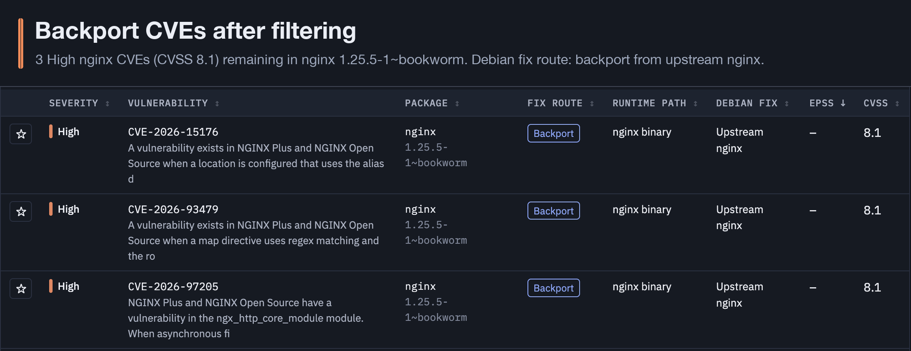
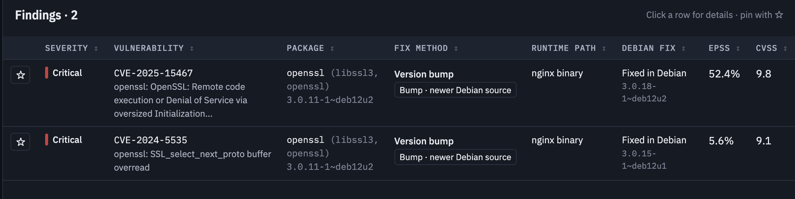

# Research Diary

- [x] Read the exercise
- [x] Run grype & trivy on my computer.
- [x] Create artifacts to view the results for my CVE's choices.
- [x] Choose CVE to fix using the artifact
  - Filtered using the artifact - High severity, type of fix, This is for the Backport:
    
  - This is for the Bump (newer Debian source), Critical severity, also using the filter (EPSS ≥ 90th percentile):
    
    - Why Runtime Path = "nginx binary": the container only runs `/usr/sbin/nginx`, so only nginx and the libraries it links to (`ldd`: libssl3, libpcre2-8-0, zlib1g, libcrypt1, libc6) can be reached by traffic. The other packages are never loaded.
    - Filter funnel in the artifact: 534 findings → **99** nginx binary →
      - Backport: **38** High → **3** Backport (the first screenshot)
      - Bump: **7** Critical → **5** Bump · newer Debian source → EPSS ≥ 90th percentile → **2** (CVE-2025-15467, CVE-2024-5535)
    - Why EPSS ≥ 90th percentile: EPSS estimates how likely a CVE is to be exploited in the wild in the next 30 days, so it keeps the bumps attackers actually use. Not used for Backport, because those CVEs have no EPSS score yet.
- [x] I choose 1 from each catagory to begin with.
- [x] Plan: Claude Code drafts a plan, review and approve it.

- [x] Build: Claude Code implements the plan.
- [x] Verify: I run the tests, and a second agent reviews the work.